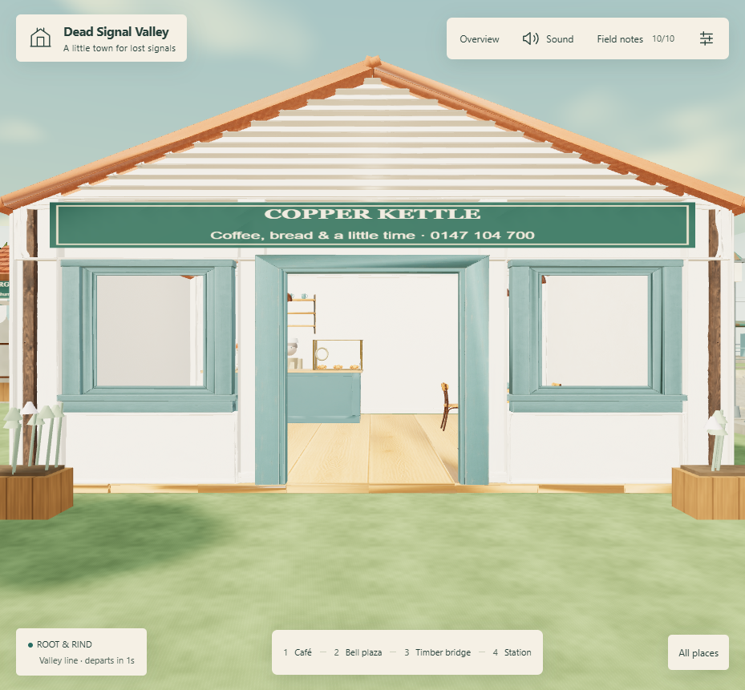

# Dead Signal Valley

[Play at deadsignal.studio](https://deadsignal.studio) · [Café assembly study](https://deadsignal.studio/building-test/)

A freely walkable Copperlight valley with 15 shops, seven landmark premises, an operating railway, 24 residents and ten quiet signals to discover. Copper Kettle Café is assembled from individual Meshy architectural parts and furnishings, with a fully enterable room. The workshop and arcade are also enterable.



## Run locally, including offline

Install Node.js 18 or later. Clone or download this repository, then:

```sh
git clone https://github.com/raiinman/dead-signal-valley.git
cd dead-signal-valley
npm run serve
```

Open **http://127.0.0.1:8771/**. No npm install, build, API key, Meshy login or online service is needed. Use `PORT=8772` on macOS/Linux or `$env:PORT=8772` in PowerShell to change the port. Keep this local server running while editing; refresh the page to see saved changes. Opening index.html directly does not support module and GLB loading.

The exact Three.js r128 build and loader are included locally. cdnjs is attempted first; the bundled fallback supports offline play. Models contain their textures. External-network-blocked browser testing passed. The complete working checkout is about 125 MB; it does not include earlier town versions or Blender backups.

```sh
npm test
npm run verify:assets
```

## Edit or hand off to another AI agent

Read [AGENTS.md](AGENTS.md), then [docs/DEVELOPMENT.md](docs/DEVELOPMENT.md). The deployed source is ordinary JavaScript, HTML and CSS in `dist/`; that folder is intentionally tracked and editable. There is no separate compiled source tree.

| File | Owns |
| --- | --- |
| `dist/app.js` | Renderer, controls, quality, time, journal and sound |
| `dist/world.js` | Town layout, shops, residents, fallback café and collision |
| `dist/modular-cafe.js` | Detailed café placement and measured walkability |
| `dist/building-test/assets.json` | The separate café parts and their transforms |
| `dist/building-test/assets/` | Editable GLB parts with embedded PBR textures |
| `dist/building-test/walk-grid.json` | Measured furniture, floor and wall clearance |
| `dist/landscape.js`, `dist/station.js` | River, planting, mountains and railway |
| `dist/materials.js`, `dist/asset-lighting.js` | Procedural surfaces and café PBR environment |
| `dist/simulation.js` | Movement, surfaces, destinations and saved state |
| `dist/style.css`, `dist/index.html` | Interface and page shell |

Import any GLB into Blender to edit it. Preserve UVs and embedded material maps when exporting. The assembly manifest supplies the transforms for separate parts. Re-measure navigation when changing room geometry; document and refresh fidelity baselines deliberately when changing accepted models.

## Controls

WASD walk, Shift run, Space jump, mouse capture or drag to look, E listen, F fly, 1-9 and 0 visit places, M mute, H hide UI. Escape releases the mouse. Mobile uses the left thumb pad and right-side drag. Settings offer Afternoon, Dusk, Night and three quality levels. Field notes are saved in the current browser only.

## Publish

Production is the existing Namecheap/cPanel hosting for `deadsignal.studio`. Publish **only the contents of `dist/`** into its `public_html/` document root, preserving hosting-specific configuration and a private rollback copy. [Deployment instructions](docs/DEPLOYMENT.md) include the exact workflow. GitHub pushes run checks; they do not automatically deploy production.

## Assets and verification

Original Meshy espresso geometry and all three 2K maps remain intact. The 15 café asset types use original accepted model hashes and source textures. Parts are shared between instances, load asynchronously, and switch to a procedural café at distance or on loading failure. The standalone assembly study reuses those assets.

See [asset provenance](docs/ASSETS.md), [runtime hashes](docs/runtime-manifest.json), [integration checks](evidence/cafe-town-integration-qa.json), [design](DESIGN.md) and [materials](MATERIALS.md). Source, collision, entry/exit, destinations, time/quality, mobile emulation, failure fallback and offline fallback were checked. Physical-phone performance and Safari remain unverified.

DOX is installed as the AGENTS.md hierarchy with its [upstream license and attribution](docs/dox/README.md). Three.js licensing is retained in the vendor folders. Making this repository public does not assign a new license to the project artwork or generated assets.
